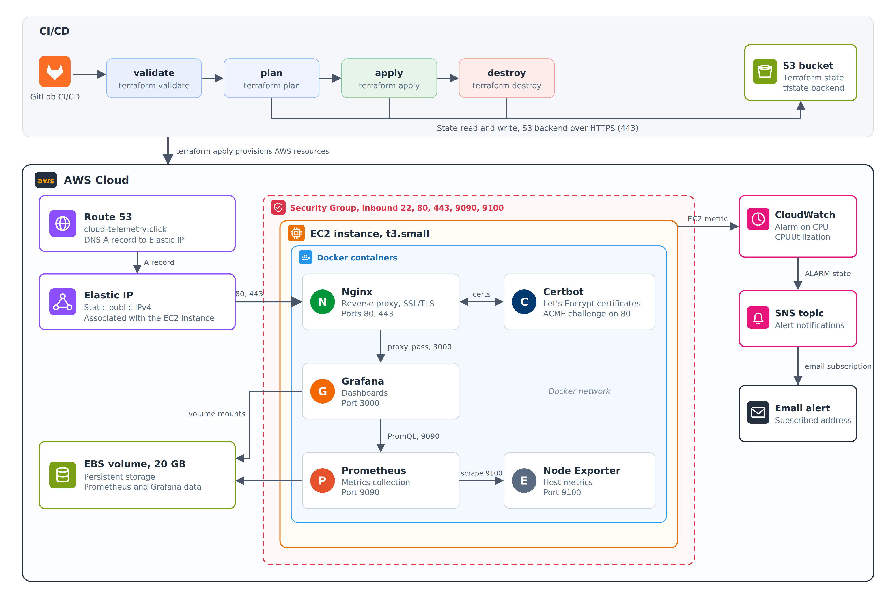
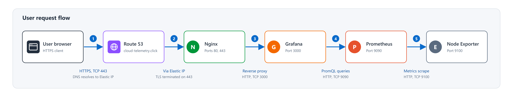
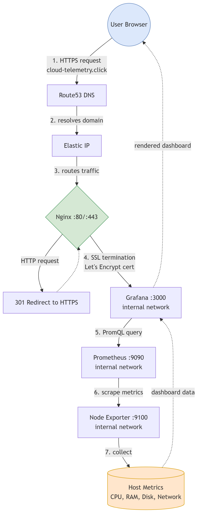
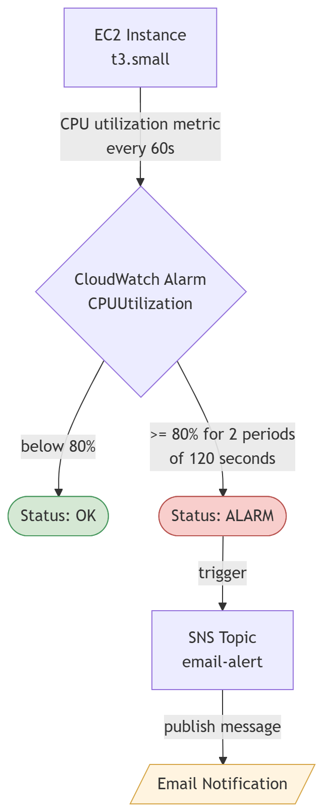

# Terraform AWS Monitoring Stack

Automated deployment of a production-ready monitoring stack on AWS using Terraform, Docker, and GitLab CI/CD.

The project provisions cloud infrastructure, configures networking and security, deploys a full monitoring stack with HTTPS, and manages the entire lifecycle through a CI/CD pipeline.

---

## Live Demo

Dashboard available at: [https://cloud-telemetry.click](https://cloud-telemetry.click)

Anonymous read-only access is enabled. Sign in is required for admin access.

---

## Architecture Overview

## User Request Flow

---

## Tech Stack

| Category | Technology |
|----------|-----------|
| Infrastructure as Code |  |
| Cloud Provider |  (EC2, EBS, EIP, Route53, CloudWatch, SNS, S3) |
| Containerization |   |
| Monitoring |    |
| Web Server |  (reverse proxy, SSL/TLS) |
| SSL Certificates |  (Certbot) |
| CI/CD |  |

---

## AWS Resources

| Resource | Purpose |
|----------|---------|
| EC2 (t3.small) | Hosts Docker containers (Amazon Linux 2023) |
| EBS (20GB, XFS) | Persistent storage for Prometheus and Grafana data |
| Elastic IP | Static public IP address |
| Security Group | Firewall rules (ports 22, 80, 443) |
| Route53 | DNS management |
| CloudWatch | CPU utilization alarm (threshold >80%) |
| SNS | Email alert notifications |
| S3 | Remote Terraform state storage |

---

## Docker Services

| Service | Port | Description |
|---------|------|-------------|
| Nginx | 80, 443 | Reverse proxy with HTTPS redirect |
| Grafana | 3000 (internal) | Metrics visualization and dashboards |
| Prometheus | 9090 (internal) | Metrics collection, scrapes every 15s |
| Node Exporter | 9100 (internal) | Host-level metrics (CPU, RAM, disk, network) |
| Certbot | - | Automated SSL certificate management |

---

## Project Structure

    terraform-aws-monitoring-stack/
    ├── main.tf                          # AWS resources and provisioners
    ├── variables.tf                     # Input variables
    ├── output.tf                        # Output values (IP, URLs)
    ├── provider.tf                      # AWS provider + S3 backend
    ├── .gitlab-ci.yml                   # CI/CD pipeline definition
    ├── .gitignore
    ├── docs/
    │   ├── architecture-diagram.png     # Architecture diagram
    │   └── user-request-flow.png        # User request flow diagram
    ├── docker/
    │   ├── docker-compose.yml           # Service definitions
    │   ├── prometheus.yml               # Prometheus scrape configuration
    │   ├── grafana-datasource.yml       # Auto-provisioned Prometheus datasource
    │   ├── grafana-dashboard.yml        # Dashboard provider configuration
    │   ├── node-exporter-dashboard.json # Pre-configured Node Exporter dashboard
    │   ├── nginx.conf                   # Reverse proxy + SSL configuration
    │   └── init-letsencrypt.sh          # SSL certificate bootstrap script

---

## CI/CD Pipeline

The GitLab CI/CD pipeline automates the entire infrastructure lifecycle:

    validate --> plan --> deploy --> destroy

| Stage | Description | Trigger |
|-------|-------------|---------|
| validate | terraform fmt and terraform validate | Automatic on push |
| plan | terraform plan with saved plan file | Automatic |
| deploy | terraform apply using saved plan | Manual approval |
| destroy | terraform destroy | Manual approval |

The plan file is passed as an artifact between stages, ensuring that the exact reviewed plan is applied during deployment.

---

## User Access Flow

---

## Alert Flow

---

## Monitoring Features

- Automated metric collection - Prometheus scrapes Node Exporter every 15 seconds
- Pre-configured dashboards - Node Exporter dashboard auto-provisioned on first boot
- Persistent data - Prometheus and Grafana data stored on dedicated EBS volume
- HTTPS - Nginx reverse proxy with auto-renewed Let's Encrypt certificates
- Alerting - CloudWatch monitors CPU utilization, SNS sends email alerts when threshold exceeded
- Anonymous access - Public read-only Viewer access to Grafana dashboards

---

## Security

- Ports 9090 (Prometheus) and 9100 (Node Exporter) are closed to public access
- Only ports 22 (SSH), 80 (HTTP redirect), and 443 (HTTPS) are exposed
- AWS credentials stored as masked and protected GitLab CI/CD variables
- SSH keys stored as protected GitLab CI/CD variables
- Terraform sensitive variables marked with sensitive = true

---

## Prerequisites

Before deploying this project, you need:

- AWS Account with programmatic access (Access Key + Secret Key)
- Terraform CLI installed
- AWS CLI installed and configured
- GitLab account with a project repository
- Registered domain in AWS Route53
- SSH key pair generated locally
- S3 bucket for Terraform remote state with versioning enabled

---

## Configuration

To deploy this project yourself, update the following files:

**variables.tf** - Update default values for your environment:

    variable "region" {
      default = "eu-north-1"                    # Your preferred AWS region
    }

    variable "ami" {
      default = "ami-01e082ac2f79f3918"          # Amazon Linux 2023 AMI for your region
    }

    variable "instance_type" {
      default = "t3.small"                       # Instance size
    }

    variable "domain_name" {
      default = "cloud-telemetry.click"          # Your registered domain
    }

    variable "email" {
      default = "your@email.com"                 # Email for CloudWatch alerts
    }

**provider.tf** - Update S3 backend configuration:

    backend "s3" {
      bucket = "your-terraform-state-bucket"     # Your S3 bucket name
      key    = "monitoring/terraform.tfstate"
      region = "eu-north-1"                      # Your region
    }

**docker/init-letsencrypt.sh** - Update domain and email:

    domains=(your-domain.com)                    # Your domain
    email="your@email.com"                       # Your email for Let's Encrypt

**docker/nginx.conf** - Update certificate paths:

    ssl_certificate     /etc/letsencrypt/live/your-domain.com/fullchain.pem;
    ssl_certificate_key /etc/letsencrypt/live/your-domain.com/privkey.pem;

**docker/docker-compose.yml** - Update Grafana root URL:

    environment:
      - GF_SERVER_ROOT_URL=https://your-domain.com

**GitLab CI/CD Variables** - Add these in Settings > CI/CD > Variables:

| Key | Type | Masked | Protected |
|-----|------|--------|-----------|
| AWS_ACCESS_KEY_ID | Variable | Yes | Yes |
| AWS_SECRET_ACCESS_KEY | Variable | Yes | Yes |
| SSH_PUBLIC_KEY | Variable | No | Yes |
| SSH_PRIVATE_KEY | File | No | Yes |

**SSH Key Pair** - Generate your own:

    ssh-keygen -t ed25519 -f ~/.ssh/aws-monitoring

---

## Deployment

### Via GitLab CI/CD (recommended)

    git push origin main
    # Pipeline runs automatically: validate, plan
    # Click "deploy infrastructure" button in GitLab UI to apply

### Manual deployment

    terraform init
    terraform plan
    terraform apply

### Teardown

Via GitLab: click the "destroy infrastructure" button in the pipeline.

Manual:

    terraform destroy

---

## Cost Estimate

| Resource | Cost |
|----------|------|
| EC2 t3.small | ~$0.02/hour |
| EBS 20GB | ~$2/month |
| Route53 Hosted Zone | $0.50/month |
| Domain (.click) | ~$3/year |
| CloudWatch, SNS, S3 | Free tier |
| **Running 24/7** | **~$17/month** |

Use terraform destroy when not needed to minimize costs.
